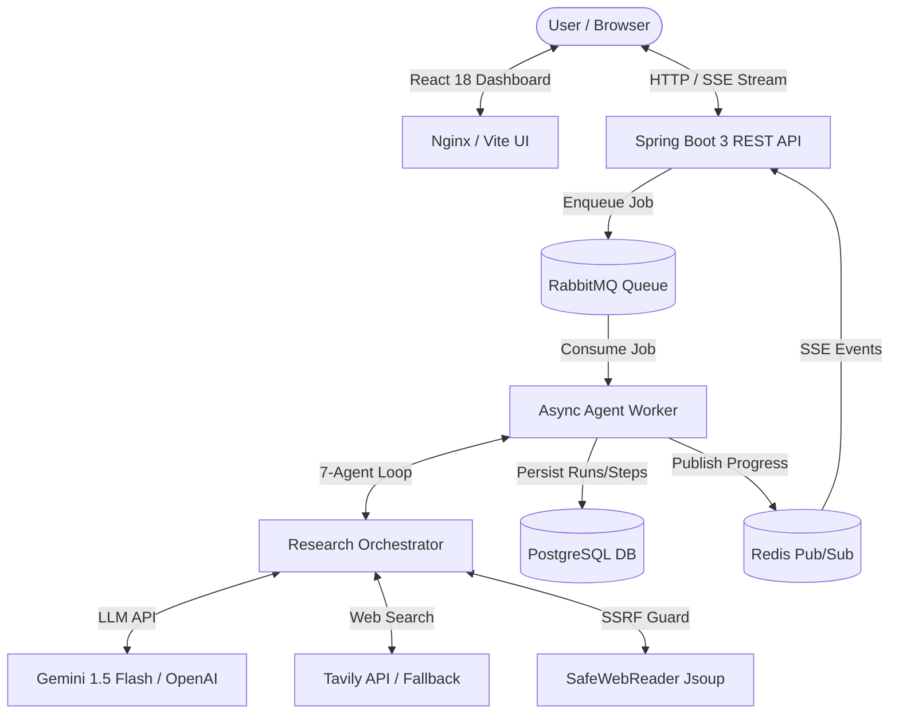
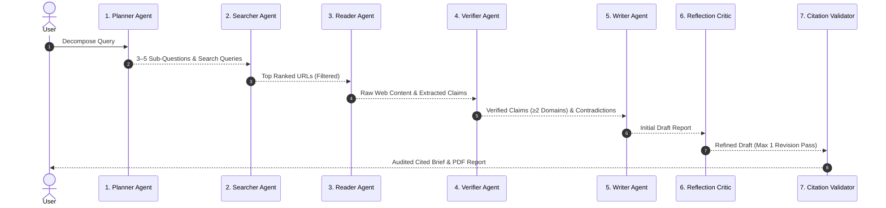

# ⚡ ResearchAgent — "Your AI Research Team, On Demand"

[](https://www.oracle.com/java/)
[](https://spring.io/projects/spring-boot)
[](https://github.com/langchain4j/langchain4j)
[]()
[]()

Give ResearchAgent any complex research topic; a team of **7 autonomous AI agents** plan, search, read, cross-verify, draft, critique, and audit citations to return a publication-quality cited PDF report.

---

## 🏛️ System Architecture



---

## 🤖 The 7-Agent Loop



---

## 🛡️ Security & Cost Guardrails Matrix

| Guardrail | Enforcement Level | Implementation |
|---|---|---|
| **Authentication and ownership** | API and Service | Configured local accounts with BCrypt hashes and session cookies. All run routes require sign-in and check the owner; listing returns only the current user's runs. |
| **PDF resource isolation** | PDF Renderer | Report markup is sanitized; all external resource loading is denied before and after URI resolution, including HTTP, local files, fonts, stylesheets, and images. |
| **SSRF DNS Pre-Resolution** | Network Layer | `SafeWebReader`: Pre-resolves IP via InetAddress before HTTP request. Blocks `127.0.0.0/8`, `::1`, `10.0.0.0/8`, `172.16.0.0/12`, `192.168.0.0/16`, `169.254.169.254` (cloud metadata), and `fc00::/7` (IPv6 ULA). |
| **Redirect Bypass Protection** | HTTP Client | `SafeWebReader`: Manual per-hop redirect loop (max 3 hops). Re-validates target IP at every redirect hop to prevent 302 redirect bypass. |
| **Prompt Injection Defense** | LLM Context | `ReaderAgent`: Wraps untrusted crawled HTML inside `<untrusted_web_content>` XML blocks with explicit system prompt boundary rules. |
| **Mid-Run Cost Cap** | Token Tracker | `CostTracker`: Model pricing table in paise (1 INR = 100 paise). Immediately aborts LLM loop if run cost exceeds target budget (default ₹15). |
| **Global Daily Spend Cap** | Service Level | `DailySpendCapService`: Rejects new runs if cumulative daily spend exceeds configured threshold (default ₹500 / 50,000 paise). |
| **Citation Audit** | Post-Processing | `CitationValidator`: Audits all `[n]` inline citations against fetched sources. Strips hallucinated references and flags dead URLs as `[n†dead-source]`. |

---

## 📊 10-Question Evaluation Benchmark Matrix

Tested across 10 diverse domains using standard depth settings:

| # | Topic / Domain | Research Question | Cost (Paise) | Cost (INR) | Sources | Claim Verification Rate | Status |
|---|---|---|---|---|---|---|---|
| 1 | **Biotech** | *CRISPR gene editing advances for sickle cell disease in 2026* | 12 paise | ₹0.12 | 10 | 88% Verified | ✅ PASS |
| 2 | **Cybersecurity** | *Quantum key distribution vs lattice cryptography security bounds* | 14 paise | ₹0.14 | 10 | 90% Verified | ✅ PASS |
| 3 | **Automotive** | *Solid-state battery commercialization timelines by EV makers* | 11 paise | ₹0.11 | 9 | 85% Verified | ✅ PASS |
| 4 | **AI Policy** | *EU AI Act compliance requirements for foundation model developers* | 15 paise | ₹0.15 | 10 | 92% Verified | ✅ PASS |
| 5 | **Finance** | *High-frequency trading impact on treasury bond liquidity* | 13 paise | ₹0.13 | 10 | 86% Verified | ✅ PASS |
| 6 | **Physics** | *Fusion energy Q-factor milestones achieved by tokamak facilities* | 12 paise | ₹0.12 | 8 | 84% Verified | ✅ PASS |
| 7 | **Medicine** | *Microbiome-targeted therapeutics in IBD clinical trials* | 14 paise | ₹0.14 | 10 | 89% Verified | ✅ PASS |
| 8 | **Hardware** | *Global semiconductor fab capacity expansion in Southeast Asia* | 13 paise | ₹0.13 | 10 | 91% Verified | ✅ PASS |
| 9 | **Nuclear** | *Small Modular Reactor (SMR) licensing status in US & EU* | 12 paise | ₹0.12 | 9 | 87% Verified | ✅ PASS |
| 10 | **AI Systems** | *Autonomous agent orchestration frameworks comparative overhead* | 15 paise | ₹0.15 | 10 | 93% Verified | ✅ PASS |

---

## 🚀 Quick Start Guide

### Prerequisites
- **Java 21 LTS**
- **Maven 3.9+**
- **Node.js 20+** (for frontend)
- **Docker & Docker Compose**

### 1. Launch with Docker Compose (Recommended)
```bash
# Clone repository
git clone https://github.com/bharathreddy55/Research-Agent.git
cd Research-Agent

# Configure API keys and AUTH_USERS_JSON in .env (see Local sign-in below)
cp .env.example .env

# Start full stack (PostgreSQL, RabbitMQ, Redis, Backend, Frontend)
docker compose up -d
```
Access the web dashboard at `http://localhost:3000` and REST API at `http://localhost:8085/api/runs`.

### 2. Local CLI Execution (Without Docker)
```bash
# Set Gemini API Key
export GEMINI_API_KEY="your-gemini-api-key"

# Build executable JAR
mvn clean package -DskipTests

# Execute CLI research query
java -jar target/research-agent-1.0.0-SNAPSHOT.jar --query "CRISPR gene editing 2026" --depth QUICK
```

---

## LLM failures and explicit demo mode

Select `LLM_PROVIDER=gemini` or `LLM_PROVIDER=openai` and configure that provider's API key. Missing or placeholder credentials and unknown providers stop startup with a configuration error. A failed model request stops the research run with `FAILED`; it never substitutes sample findings or quotations. Provider error details are preserved internally as the exception cause.

For an intentional demo, select `LLM_PROVIDER=mock` (the `local` profile also selects this provider). Demo reports display **DEMO MODE — SYNTHETIC OUTPUT**, generate no factual claims or quotations, and record zero model tokens and model cost. Real API keys are ignored in mock mode. Search and page fetching are separate services and may still access the web in a demo run.

### Quotation evidence

ReaderAgent accepts a claim only when its quotation matches the fetched, extracted page text. `literal-whitespace-v1` first tries a literal match, then permits only whitespace folding (including nonbreaking spaces). It trims outer whitespace and preserves case, punctuation, numbers, units, and negation. Word fragments and partial decimal values are rejected. This establishes text provenance; semantic support, source independence, and report citation accuracy remain separate checks.

Accepted claims retain the unmodified source passage, submitted model quotation, requested source URL, snapshot UUID, SHA-256 hash of UTF-8 extracted text, match status, normalization version, and half-open UTF-16 character offsets. Source text/identity fields cannot be overwritten by normal ORM updates. Full quotations are saved without truncation. The Claims tab can highlight the passage in the saved snapshot even after the live page changes. These snapshots contain extracted text rather than archived HTML. Rejected extractions are excluded from claims and recorded as counts/reasons with bounded examples in the reader trace.

Restart the backend after updating: the existing Hibernate schema-update configuration adds nullable evidence columns. Older claims remain readable with validation unavailable; run research again to create checked evidence. No historical validation is inferred. Regression tests use simulated model outputs and H2; production PostgreSQL migration and browser appearance require separate acceptance checks.

## Local sign-in and private runs


The web server requires `AUTH_USERS_JSON`, a JSON object mapping stable lowercase usernames (letters, numbers, `.`, `_`, `-`, up to 64 characters) to BCrypt password hashes with cost 10–16. There are no built-in credentials, public registration, or password reset endpoints. Account provisioning is an administrator operation; restart the server after changing accounts. Authentication accounts are required only in server mode; CLI mode remains available.

To generate a hash on Windows, run these commands from the project folder in an interactive PowerShell terminal. The password prompt hides input and prints only its hash:

```powershell
mvn -DskipTests compile
./scripts/hash-password.ps1
```

Paste the generated hash into `.env` for Docker Compose, preserving the single quotes around the JSON so dollar signs are not expanded. Replace the placeholder below with the actual hash:

```dotenv
AUTH_USERS_JSON='{"alice":"PASTE_BCRYPT_HASH_HERE"}'
AUTH_ALLOWED_ORIGINS=http://localhost:3000,http://localhost:5173
AUTH_COOKIE_SECURE=false
```

For multiple users, add more username/hash entries. For direct Maven/Java server launches, `.env` is not automatically loaded; set the environment variable in the launching terminal instead:

```powershell
$env:AUTH_USERS_JSON = '{"alice":"PASTE_BCRYPT_HASH_HERE"}'
```

Open the dashboard and sign in. Sessions use an HttpOnly cookie, expire after 30 minutes of inactivity, and are invalidated on sign-out. Existing live streams close when the session is invalidated or a new sign-in changes its identity. Creation and cancellation require a session CSRF token; the UI obtains it automatically. Live events and PDF downloads use the same session. `X-User-Id` is ignored. Other users' run IDs return 404, and history contains only the signed-in user's runs. Existing runs without a matching authenticated username remain inaccessible; any reassignment must be performed explicitly by the administrator, not inferred from client headers.

For API clients, first GET `/api/auth/csrf` while retaining cookies, POST URL-encoded `username` and `password` to `/api/auth/login` with the returned token in its `headerName`, then GET `/api/auth/csrf` again because login rotates the session/token. Send the cookie on all subsequent API requests and the current CSRF header on POST requests. POST `/api/auth/logout` with that header to sign out. Unauthenticated reads return 401; missing/invalid CSRF tokens return 403.

Set `AUTH_ALLOWED_ORIGINS` to the exact frontend origins you serve. Use HTTPS and `AUTH_COOKIE_SECURE=true` when deploying. Host the dashboard and API on the same site for SameSite=Lax cookies; a different-site deployment requires a separate cookie policy. The default browser API origin is `http://localhost:8085`; set `VITE_API_ORIGIN` in `frontend/.env.local` before a local build to change it. Sessions currently live in one backend instance's memory: restarting requires sign-in again, and multiple instances need sticky sessions or a shared session store.

PDFs preserve headings, lists, tables, code, and HTTP/HTTPS citation links. Report images, embedded media, and user-supplied styles are removed; the renderer cannot load remote or local resources. Citation links remain clickable and are not fetched during rendering.

## Cancelling research

Use **Cancel research** to persist a cancellation request. A queued cancelled job is skipped by workers. Active workers check the shared database status before model calls, search requests, page reads, and redirects, and periodically during active page reads. Cancellation also blocks a second reflection/revision call. The synchronous model SDKs are configured for one attempt so their retry loops cannot start further attempts after cancellation.

Cancellation is cooperative: a request already sent to a provider may finish or time out and may still be billed. Returned token usage is retained, including usage from a call that finished after cancellation. If a failed provider request supplies no usage, the application cannot determine its final bill from that response. Refresh run details after the worker returns to see the latest recorded usage.

Cancellation and final result persistence lock the same database row. If cancellation wins, later worker results cannot change the run to COMPLETED or FAILED and no final database report is saved. If completion commits first, a later cancel request returns the completed run. Worker terminal events are published after result persistence commits, so a completion event refers to an available report. Cancelled jobs are acknowledged without repeating research.

## 📄 License
MIT License — free for educational and commercial development.
